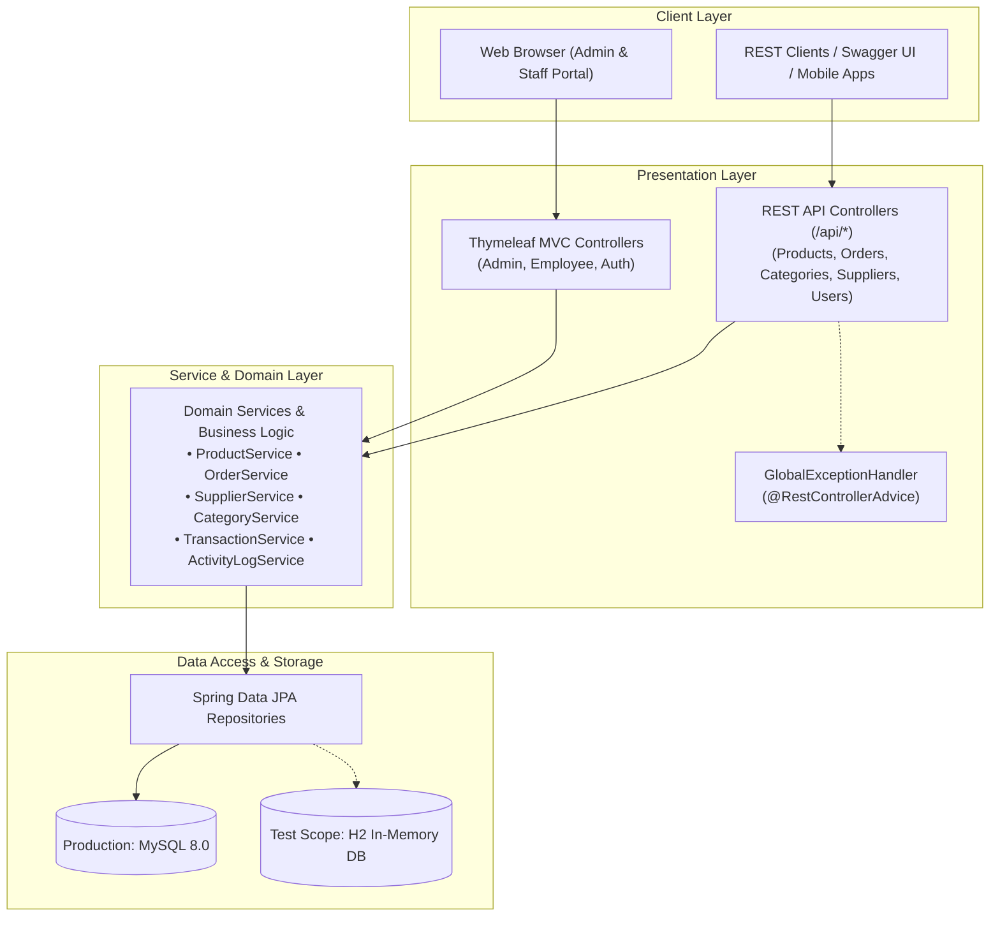
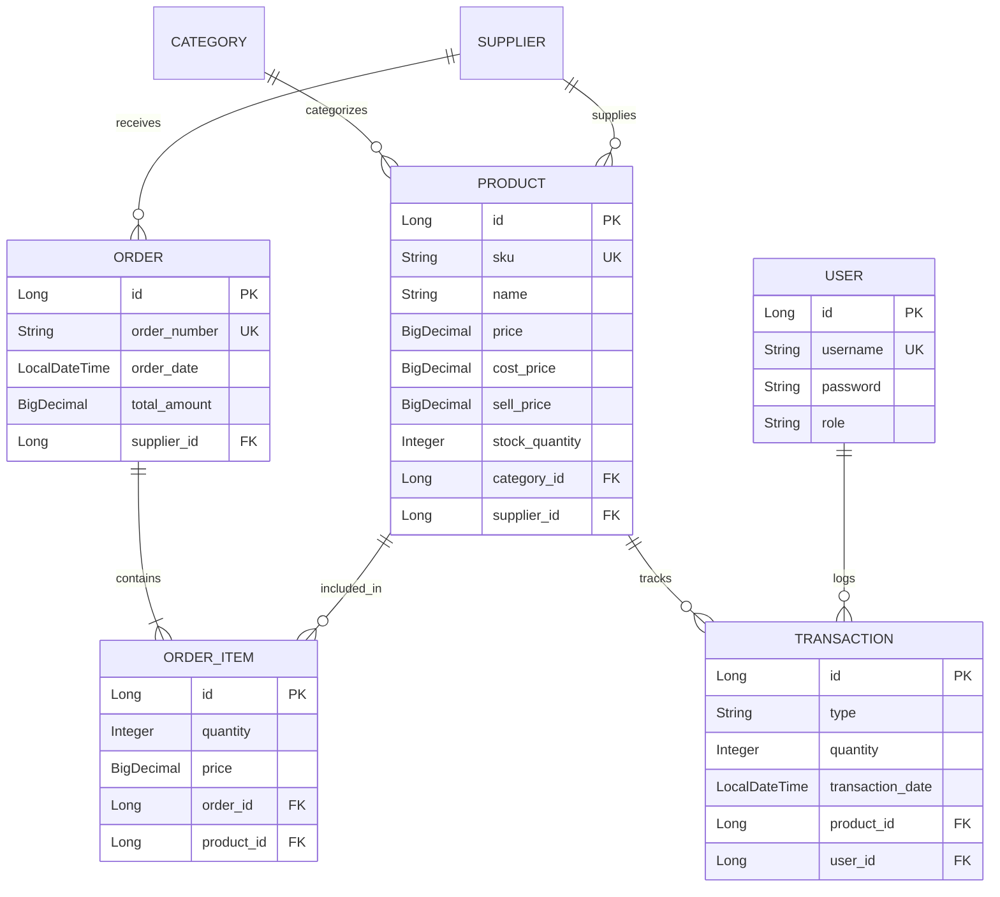

# 📦 IMS PRO - Enterprise Inventory Management System

[](https://openjdk.org/)
[](https://spring.io/projects/spring-boot)
[](https://www.mysql.com/)
[](https://www.docker.com/)
[](https://github.com/features/actions)
[](http://localhost:8080/swagger-ui.html)
[](https://junit.org/junit5/)
[](LICENSE)

A robust, enterprise-grade **Inventory Management & Procurement System** built with **Java 17**, **Spring Boot 3**, and **MySQL 8.0**. Features role-based access control (Admin & Staff), analytical KPI dashboards with Chart.js, automated supplier purchase orders, standardized RESTful APIs with OpenAPI/Swagger, comprehensive Mockito test suites, containerization, and an automated GitHub Actions CI/CD pipeline.

---

## 🏛️ System Architecture

The project follows clean architectural principles with strict separation of concerns across presentation, domain logic, persistence, and automated infrastructure.



---

## ✨ Key Features

### 📊 1. Analytical Executive Dashboard
* **4 Operational Metric Cards:** Real-time tracking of Total Products, Low Stock alerts ($\le 5$ units), Monthly Orders, and Active Suppliers.
* **Interactive Chart.js Visualizations:**
  * **Orders by Month:** Historical 5-month trend line chart.
  * **Distribution by Category:** Product density grouped by category.
* **Live System Activity Feed:** Audited event logs (Product creation, Order fulfillment, Supplier updates) with human-friendly relative timestamps (*"Just now"*, *"X hours ago"*).

### 🛒 2. Procurement & Order Management
* **Automated Stock Replenishment:** Creating purchase orders automatically increments product stock levels inside an atomic `@Transactional` boundary.
* **Supplier Linking:** Direct tracking of purchase order costs, item quantities, and supplier contact relationships.

### 🔌 3. Production REST API & Swagger UI
* Full REST API coverage for Products, Orders, Categories, Suppliers, Inventory Movements, and Users.
* **OpenAPI 3 / Swagger Documentation:** Live interactive testing at `/swagger-ui.html`.
* **Standardized RFC 7807 Error Handling:** Uniform JSON responses for `404 Not Found`, `400 Bad Request`, `409 Conflict`, and input validation failures.

### 🛡️ 4. Role-Based Access Control (RBAC)
* **Admin Portal (`/admin/**`):** Full control over product catalog, financial metrics, user accounts, suppliers, and procurement.
* **Staff/Employee Portal (`/employee/**`):** Streamlined interface for recording daily stock movements (Stock-In, Stock-Out, Sale, Return) with submission confirmation modals.

---

## 🗄️ Database Entity-Relationship Diagram (ERD)



---

## 🚀 Quick Start Guide

### Option 1: Run with Docker Compose (Recommended)
Run the entire application and MySQL 8.0 database with a single command:

```bash
docker compose up --build
```

* **Web Application:** `http://localhost:8080/`
* **Swagger API UI:** `http://localhost:8080/swagger-ui.html`
* **OpenAPI JSON Docs:** `http://localhost:8080/v3/api-docs`

---

### Option 2: Run Locally with Maven

#### Prerequisites
* **Java 17** or higher
* **MySQL 8.0** (running on port `3306` with database `inventory_system` or XAMPP)

```bash
# Clone the repository
git clone https://github.com/yourusername/ims.git
cd ims

# Build and run
./mvnw spring-boot:run
```

---

### ⚡ Developer Task Runner (`make.bat` / `Makefile`)

For convenience, a Windows task runner (`make.bat`) and Unix `Makefile` are provided at the root of the repository:

```cmd
# Windows (Command Prompt or PowerShell)
.\make.bat help          # View all available shortcuts
.\make.bat test          # Run full automated test suite (15 tests)
.\make.bat run           # Start Spring Boot application locally
.\make.bat docker-up     # Launch App + MySQL with Docker Compose
.\make.bat docker-down   # Stop Docker containers
.\make.bat swagger       # Open Swagger UI in browser
```

```bash
# Linux / macOS / Git Bash
make help
make test
make run
make docker-up
```

---


## 🧪 Automated Testing Suite

The project includes unit and integration tests using **JUnit 5**, **Mockito**, **MockMvc**, and an isolated **in-memory H2 database** (`application.properties` in test scope).

```bash
# Execute the entire test suite
./mvnw test
```

### Test Coverage Highlights
* **`ProductServiceTest`:** Validates stock increment/decrement, insufficient stock guards, valuation calculations, and thresholds.
* **`OrderServiceTest`:** Verifies atomic purchase order creation, stock replenishment, and monthly aggregation mapping.
* **`ProductControllerTest`:** Tests REST endpoints with MockMvc verifying HTTP `200 OK`, `404 Not Found`, and JSON error responses.
* **`ImsApplicationTests`:** Ensures Spring ApplicationContext loads cleanly.

---

## ⚙️ CI/CD Pipeline (GitHub Actions)

On every `push` and `pull_request` to `main`:
1. **Build & Test:** Sets up JDK 17, caches Maven dependencies, and runs all 15 unit and integration tests.
2. **Package:** Compiles the optimized Spring Boot executable JAR.
3. **Artifact Publishing:** Automatically publishes Surefire test reports.
4. **Docker Verification:** Builds the container image using multi-stage Docker build caching to ensure zero deployment regressions.

See [`.github/workflows/ci.yml`](.github/workflows/ci.yml).

---

## 🔑 Default Credentials

Upon startup, the system seeds initial demo data and a default administrator account:

| Role | Username | Password | Access Portal |
| :--- | :--- | :--- | :--- |
| **Admin** | `admin` | `123456` | `/admin/dashboard` |
| **Staff** | `staff` | `123456` | `/employee/dashboard` |

---

## 🛠️ Technology Stack

| Category | Technology |
| :--- | :--- |
| **Backend Framework** | Spring Boot 3.5.6 (Spring Web, Spring Data JPA, Spring Validation, Actuator) |
| **Language** | Java 17 |
| **Databases** | MySQL 8.0 (Production / Docker), H2 In-Memory (Test Suite) |
| **Template Engine** | Thymeleaf + HTML5 / CSS3 / JavaScript |
| **UI Components** | Bootstrap 5, Font Awesome 6, Chart.js |
| **API Documentation** | OpenAPI 3 / SpringDoc Swagger UI |
| **Testing** | JUnit 5, Mockito, Spring Test (MockMvc), AssertJ |
| **Containerization** | Docker, Docker Compose (Multi-stage build) |
| **CI/CD** | GitHub Actions |

---

## 📄 License
This project is licensed under the Apache License 2.0 - see the [LICENSE](LICENSE) file for details.
