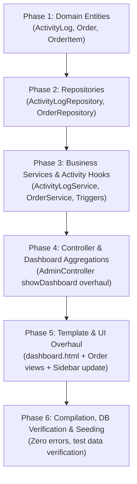

# SPEC-KIT: Implementation Plan - Order System & Dashboard Redesign

**Plan ID:** `PLAN-DASH-001`  
**Specification Ref:** [`specs/features/dashboard_and_activity_redesign_spec.md`](./dashboard_and_activity_redesign_spec.md)  
**Status:** `READY FOR EXECUTION`  
**Target:** IMS PRO (`ims` module)  

---

## 1. Plan Overview & Objectives
Transform the current IMS PRO system to match the operational B2B workflow and visual layout demonstrated in the reference project (`inventory-management-API` & `inventory-management-front`):
- **Deprecate retail sales** and implement **Supplier Orders** (`Order` + `OrderItem`).
- **Implement automated Activity Logging** (`ActivityLog`) across domain entities.
- **Redesign the Admin Dashboard** to display the 4 operational metric cards, 2 analytical charts ("Orders by Month" and "Distribution by Category"), and the "Recent Activity" feed.
- **Preserve IMS PRO visual styling** (clean Bootstrap 5, white cards, soft shadows, rounded borders, and gradient accents).

---

## 2. Phased Execution Roadmap

---

## 3. Detailed Phase Breakdown

### Phase 1: Data Model Layer (Persistence Entities)
1. **`com.ims.ims.model.ActivityLog`**:
   - Fields: `id` (Long, PK), `type` (String), `title` (String), `description` (String, columnDefinition="TEXT"), `createdAt` (LocalDateTime).
   - Helper method: `getTimeAgo()` to return `"Just now"`, `"X hours ago"`, or `"More than 24 hours ago"`.
2. **`com.ims.ims.model.Order`**:
   - Fields: `id` (Long, PK), `orderNumber` (String, Unique), `orderDate` (LocalDateTime), `supplier` (`@ManyToOne Supplier`), `items` (`@OneToMany OrderItem` with CascadeType.ALL, orphanRemoval=true).
3. **`com.ims.ims.model.OrderItem`**:
   - Fields: `id` (Long, PK), `quantity` (int), `price` (BigDecimal), `order` (`@ManyToOne Order`), `product` (`@ManyToOne Product`).

---

### Phase 2: Repository Layer
1. **`com.ims.ims.repository.ActivityLogRepository`**:
   - `List<ActivityLog> findTop5ByOrderByCreatedAtDesc()`
2. **`com.ims.ims.repository.OrderRepository`**:
   - `List<Order> findByOrderDateBetween(LocalDateTime start, LocalDateTime end)`
   - JPQL query `countOrdersGroupedByMonth(LocalDateTime startDate, LocalDateTime endDate)` for chronological monthly grouping.
   - `long countByOrderDateBetween(LocalDateTime start, LocalDateTime end)`

---

### Phase 3: Service Layer & Domain Logging Hooks
1. **`com.ims.ims.service.ActivityLogService`**:
   - `logActivity(String type, String title, String description)`
   - `getRecentActivities()`: returns top 5 logs.
2. **`com.ims.ims.service.OrderService`**:
   - `createOrder(Long supplierId, List<OrderItemRequest> items)`:
     - Generates UUID/readable `orderNumber`.
     - Validates supplier & products.
     - Adds quantity to each product's `stockQuantity` (Stock In).
     - Persists `Order` and `OrderItem` records.
     - Calls `activityLogService.logActivity("ORDER", "New Order Created", "Order #" + orderNumber + " for Supplier " + supplier.getName())`.
   - `countOrdersThisMonth()`: counts orders from `1st of current month` to `now()`.
   - `getOrderCountLastMonths(int months)`: returns last 5–6 months with month names and order counts (June $\rightarrow$ October).
   - `getAllOrders()` and `getOrderById(Long id)`.
3. **Domain Event Hooks**:
   - In `CategoryService.createCategory()`: log `"New Category Created"` (`"Category #" + id + " with the name of " + name`).
   - In `SupplierService.createSupplier()`: log `"New Supplier Created"` (`"Supplier #" + id + " with the name of " + name`).
   - In `ProductService.createProduct()`: log `"New Product Created"` (`"Product #" + id + " for Supplier " + supplierName`).

---

### Phase 4: Controller Layer
1. **Overhaul `AdminController.showDashboard()`**:
   - **Delete** all legacy financial calculations (gross profit, net profit, tax calculations, top 5 products by revenue).
   - **Inject** operational metrics:
     - `totalProducts`: count of non-deleted products.
     - `lowStockCount`: count of products where `stockQuantity <= 5`.
     - `lowStockStatus`: `"Stock in order"` if `lowStockCount == 0`, else `"Requires attention"`.
     - `monthlyOrdersCount`: count from `orderService.countOrdersThisMonth()`.
     - `activeSuppliersCount`: count of suppliers.
     - `monthlyOrdersData`: monthly counts JSON for line chart.
     - `categoryDistributionData`: category names and stock quantities JSON for bar chart.
     - `recentActivities`: top 5 activity logs.
2. **Add Order Management Endpoints**:
   - `GET /admin/orders`: List all supplier orders.
   - `GET /admin/orders/add`: Order creation form.
   - `POST /admin/orders/add`: Process order creation.
   - `GET /admin/orders/view/{id}`: View order details.

---

### Phase 5: UI & Template Layer (`admin/dashboard.html`)
1. **Metric Cards (Row 1)**:
   - 4-column responsive grid (`col-12 col-md-6 col-lg-3`).
   - Card 1: **Total Products** $\rightarrow$ Count, subtext: `📈 +2.5% from last month` (green).
   - Card 2: **Low Stock** $\rightarrow$ Count, subtext: `Stock in order` (gray) or `⚠️ Requires attention` (red badge).
   - Card 3: **Monthly Orders** $\rightarrow$ Count, subtext: `📈 +5% from yesterday` (blue).
   - Card 4: **Active Suppliers** $\rightarrow$ Count, subtext: `No changes from last month` (gray).
2. **Visual Charts (Row 2)**:
   - 2-column responsive grid (`col-12 col-lg-6`).
   - Left Card: **Orders by Month** (Monthly order analysis) $\rightarrow$ Line chart with smooth spline curve, blue line `#3b82f6`, dots at points, X-axis showing month names (June, July, August, September, October).
   - Right Card: **Distribution by Category** (Products by category) $\rightarrow$ Bar chart, purple `#8B5CF6`, category names on X-axis, stock quantity on Y-axis.
3. **Recent Activity Feed (Row 3)**:
   - Full-width card with header: **Recent Activity** / *Latest system updates*.
   - List group or divided rows:
     - Left side: Bold Title (`New Order Created`, `New Product Created`, etc.) + muted description.
     - Right side: Relative time badge (`More than 24 hours ago`, `Just now`, `2 hours ago`).
4. **Navigation & Sidebar**:
   - Update sidebar navigation link to point to **Order Management** (`/admin/orders`) instead of Transactions.
5. **Create Order Views**:
   - `admin/orders.html` for listing orders.
   - `admin/add-order.html` for creating a new supplier order.

---

### Phase 6: Verification, Compilation & Initial Seeding
1. **Compilation Check**:
   - Run `.\mvnw.cmd compile` to verify 100% compilation success without warnings.
2. **Initial Seeding Helper**:
   - If the database has no activity logs or orders yet, automatically populate baseline initial logs matching the user's reference screenshot so the dashboard immediately renders populated and looks identical to the target screenshot.
3. **End-to-End Validation**:
   - Test creating a category, supplier, product, and order $\rightarrow$ verify stock increases $\rightarrow$ verify dashboard cards, charts, and activity log update in real time.

---

## 4. Acceptance Criteria Checklist
- [ ] 4 operational cards display exact target titles and subtexts.
- [ ] Low stock threshold is strictly $\le 5$.
- [ ] Orders by Month renders as a line chart with monthly history.
- [ ] Distribution by Category renders as a purple bar chart.
- [ ] Recent Activity renders recent activities with human-readable relative time.
- [ ] Legacy financial cards (tax, profit margin, revenue) are completely removed from the dashboard.
- [ ] Full project compiles successfully (`mvnw compile` BUILD SUCCESS).
