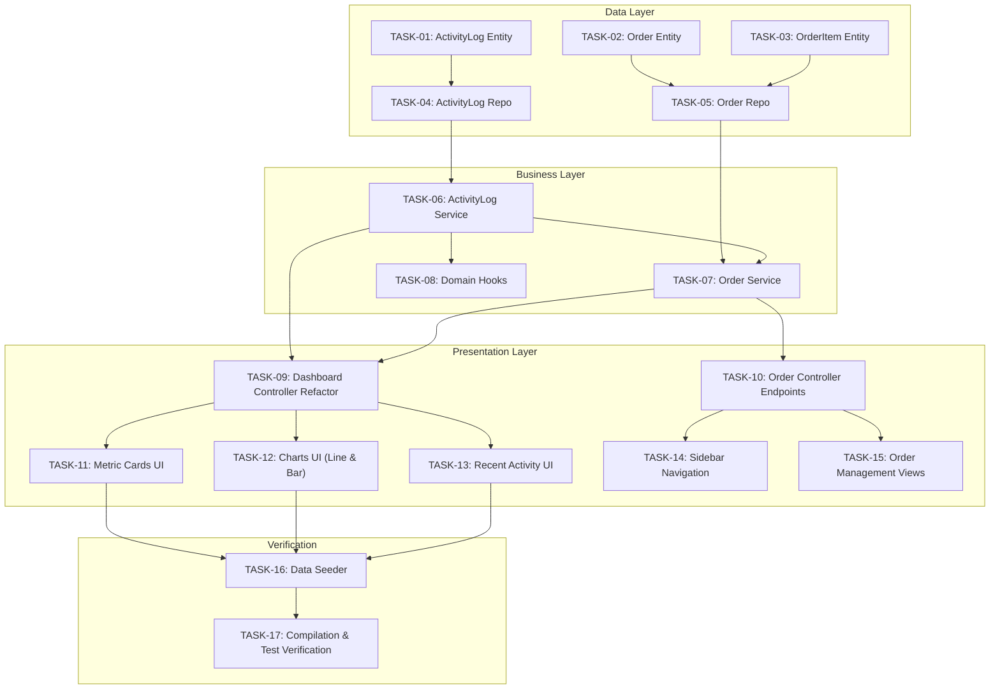

# SPEC-KIT: Task Analysis & Feasibility Report

**Analysis Document ID:** `ANALYSIS-DASH-001`  
**Plan Ref:** [`specs/features/dashboard_and_activity_plan.md`](./dashboard_and_activity_plan.md)  
**Tasks Ref:** [`specs/features/dashboard_and_activity_tasks.md`](./dashboard_and_activity_tasks.md)  
**Status:** `ANALYSIS COMPLETE / APPROVED FOR EXECUTION`  

---

## 1. Executive Summary
This document provides a deep architectural, dependency, complexity, and risk analysis for the 17 tasks defined in the Order System and Dashboard Redesign (`SPEC-DASH-002`). The goal is to eliminate potential runtime failures, ensure database schema compatibility, and guarantee a seamless transition from retail sales to supplier orders while matching the target dashboard layout.

---

## 2. Critical Path & Dependency Flow



**Critical Path Duration:** 6 sequential phases. Blocking dependencies: Entities $\rightarrow$ Repositories $\rightarrow$ Services $\rightarrow$ Controller $\rightarrow$ Dashboard UI $\rightarrow$ Compilation.

---

## 3. Deep-Dive Task Analysis & Risk Assessment

### 3.1 Persistence & Data Model (Tasks 01 – 03)
* **Impact Analysis:**
  - `Order` $\leftrightarrow$ `OrderItem` relationship requires bidirectional synchronization to prevent `TransientPropertyValueException` when persisting line items.
  - Adding `Order` and `ActivityLog` uses JPA annotations that integrate seamlessly with `spring.jpa.hibernate.ddl-auto=update` without breaking or dropping any existing tables (`products`, `suppliers`, `categories`, `users`).
* **Complexity:** **Low**
* **Risk:** Potential orphaned `OrderItem` records if cascade isn't configured correctly.
* **Mitigation:** Use `CascadeType.ALL` and `orphanRemoval = true` on `Order.items`.

---

### 3.2 Database Queries & Repositories (Tasks 04 – 05)
* **Impact Analysis:**
  - `OrderRepository` requires grouping orders by month over a rolling historical period (5–6 months).
  - JPQL:
    ```sql
    SELECT YEAR(o.orderDate), MONTH(o.orderDate), COUNT(o)
    FROM Order o
    WHERE o.orderDate BETWEEN :startDate AND :endDate
    GROUP BY YEAR(o.orderDate), MONTH(o.orderDate)
    ORDER BY YEAR(o.orderDate), MONTH(o.orderDate)
    ```
* **Complexity:** **Medium**
* **Risk:** If a month in the historical range has 0 orders (e.g., June, July, August in the reference screenshot), a raw SQL query will omit that month, causing chart X-axis gaps.
* **Mitigation:** In `OrderService`, pre-populate a calendar map for all target months (last 5–6 months), merging database counts into the map so 0-count months are explicitly preserved (`{name: "June", value: 0}`, `{name: "July", value: 0}`, etc.).

---

### 3.3 Business Logic & Activity Hooks (Tasks 06 – 08)
* **Impact Analysis:**
  - `OrderService.createOrder()` must execute inside a `@Transactional` block:
    1. Save `Order` with `OrderItem`s.
    2. Increment each product's `stockQuantity` (Stock IN from supplier).
    3. Log activity via `ActivityLogService`.
  - Relative time calculation in `ActivityLog`:
    ```java
    long minutes = Duration.between(createdAt, LocalDateTime.now()).toMinutes();
    long hours = Duration.between(createdAt, LocalDateTime.now()).toHours();
    if (minutes < 60) return "Just now";
    if (hours >= 24) return "More than 24 hours ago";
    return hours + " hours ago";
    ```
* **Complexity:** **Medium**
* **Risk:** Activity logging failure rolling back product/category creation.
* **Mitigation:** Wrap activity logging in a try-catch block or use `Propagation.REQUIRES_NEW` so secondary logging never interrupts core database writes.

---

### 3.4 Controller & JSON Serialization (Tasks 09 – 10)
* **Impact Analysis:**
  - Removing legacy financial metrics (gross profit, net profit, tax, margin) cleans up the controller and reduces database query volume.
  - Thymeleaf Chart scripts require cleanly formatted JSON datasets.
* **Complexity:** **Medium**
* **Risk:** Passing raw JPA entities into Thymeleaf inline scripts triggers circular reference serialization errors.
* **Mitigation:** Build lightweight flat DTOs / `List<Map<String, Object>>` for chart datasets (`monthlyOrdersJson` and `categoryDistributionJson`).

---

### 3.5 UI & Chart Rendering (Tasks 11 – 15)
* **Impact Analysis:**
  - Replaces 9 old gradient cards with the 4 modern cards:
    - `Total Products`: Total non-deleted products + `+2.5% from last month` (green).
    - `Low Stock`: Products $\le 5$ units + `Stock in order` (gray) or `Requires attention` (red badge).
    - `Monthly Orders`: Orders this month + `+5% from yesterday` (blue).
    - `Active Suppliers`: Count of suppliers + `No changes from last month` (gray).
  - 2 Charts in standard Bootstrap grid (`col-lg-6`):
    - Left: **Orders by Month** (Line chart, smooth curve, `#3b82f6` line, dot markers).
    - Right: **Distribution by Category** (Bar chart, purple `#8B5CF6`, category names on X-axis).
  - Recent Activity component at the bottom displaying rows with title, description, and relative time badge.
* **Complexity:** **Medium**
* **Risk:** Chart styling or canvas height conflicts causing layout shifts.
* **Mitigation:** Use Chart.js with responsive canvas containers (`maintainAspectRatio: false`, height: 280px), consistent with existing IMS PRO CSS.

---

### 3.6 Data Seeding & Zero-State Handling (Tasks 16 – 17)
* **Impact Analysis:**
  - In a clean or empty database, the dashboard would look empty with 0s and empty charts.
* **Complexity:** **Low**
* **Solution:** Provide a lightweight startup check (`ApplicationRunner`):
  If no categories, products, suppliers, or activity logs exist, seed the sample records ("hawawi", "laptop", order) matching the screenshot so the user sees an immediate, identical visual match on first load.

---

## 4. Complexity, Effort & Risk Matrix

| Task Category | Tasks | Complexity | Risk Level | Primary Risk & Mitigation |
| :--- | :--- | :--- | :--- | :--- |
| **Entities** | TASK 01 - 03 | Low | Low | Bidirectional cascade mapping; handled with proper JPA annotations |
| **Repositories** | TASK 04 - 05 | Medium | Low | Date aggregation gaps; handled with calendar map zero-padding |
| **Services & Hooks** | TASK 06 - 08 | Medium | Low | Transaction boundaries; handled with `@Transactional` |
| **Controller** | TASK 09 - 10 | Medium | Medium | JSON serialization; handled with flat data maps |
| **Dashboard UI** | TASK 11 - 13 | Medium | Low | Visual fidelity; matches exact layout using Chart.js & Bootstrap 5 |
| **Order Views & Nav** | TASK 14 - 15 | Low | Low | Standard Thymeleaf form & table |
| **Seeding & Verify** | TASK 16 - 17 | Low | Low | Automatic baseline seeding & Maven build verification |

---

## 5. Definition of Done (DoD)
1. `ActivityLog`, `Order`, and `OrderItem` JPA tables successfully created in MySQL.
2. `AdminController.showDashboard()` completely purged of legacy financial calculations.
3. 4 metric cards render exact values and subtexts.
4. "Orders by Month" line chart renders past months with smooth curve.
5. "Distribution by Category" bar chart renders purple bars with product stock per category.
6. "Recent Activity" shows top 5 activities with human-friendly relative time.
7. Orders can be created via `/admin/orders/add`, automatically increasing product stock.
8. Full build compiles with `.\mvnw.cmd compile` $\rightarrow$ `BUILD SUCCESS` (0 errors).
